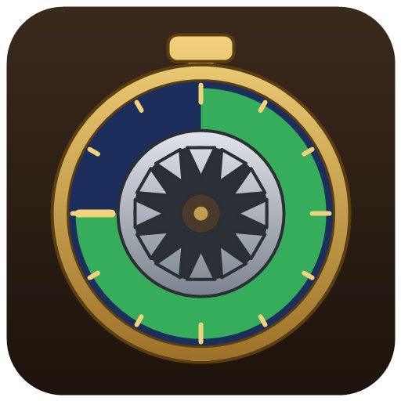

<p align="center"></p>

# Hunter Trap Timer

An addon for WoW Forever (the `_forever_` client, 1.60.x) that shows how
long your hunter traps stay armed before they vanish.

- **Countdown for your armed traps.** When you put down an Immolation,
  Freezing, Frost or Explosive Trap, an icon shows it with a clock sweep and
  the seconds left: an armed trap lasts 60 seconds unless something steps on
  it. A fire trap (Immolation, Explosive) and a frost trap (Freezing, Frost)
  can be down at once, each with its icon; a new trap replaces only the one
  of its own school.
- **Shown like a totem.** By default the icon looks like a shaman's
  totem: round, in a totem's ring, with the seconds below it. It sits under
  your portrait, clear of your pet's frame, at the player frame's scale
  (following it when Edit Mode moves or resizes it); with both traps down,
  the frost trap's icon goes to the left of the fire trap's, under your
  level. Its tooltip, as a
  totem's, gives the trap's name, rank and time left. The options make the
  icons square, put the seconds on them, resize them, or free them to be
  dragged anywhere.
- **Warning before it runs out.** With 10 seconds left (adjustable, or off)
  the seconds turn red, the icon flashes and the trap's sound plays.
- **Notices when a trap springs, however far away you are.** A trap that
  springs is gone, so its icon goes, even with the enemy out of sight or
  enemy nameplates off.
- **How long its effect lasts.** Once a trap springs, its icon stays and
  counts down its effect: Freezing Trap's freeze (the seconds in ice blue)
  until the enemy breaks free; Immolation Trap's burn (in orange) until the
  enemy it burns dies or you leave combat; Explosive Trap's fire (in orange)
  and Frost Trap's ice (in ice blue) for the 20 and 30 seconds they stay on
  the ground. Its seconds are rounded down, as the game's aura tooltips
  round them (the armed trap's are rounded up, as a totem's). The countdown
  can be turned off in the options.
- **A sound for each trap.** On the options' Sounds page, each trap has its
  own sound for the warning and one for when its effect ends, out of nine of
  the game's sounds or none; choosing one plays it. By default the warnings
  play the raid warning, and every effect's end the third alarm clock.
- **Keeps the countdowns through a `/reload`.** The traps stay in the world
  when you reload the interface, and so do their countdowns.
- **Every client language.** The texts are in English, German, Spanish (EU
  and Latin America), French, Italian, Korean, Portuguese (Brazil, also used
  by Portugal's client), Russian and Chinese (simplified and traditional).

## Installing

1. Copy the `HunterTrapTimer` folder into
   `World of Warcraft\_forever_\Interface\AddOns\`.
2. Put a trap down, or try `/htt test`. To move the icons, `/htt unlock`,
   drag them, then `/htt lock`; **Reset position** in the options puts them
   back under the player frame.
3. The options are under the game menu: Options > AddOns > Hunter Trap Timer
   (or `/htt`).

The settings are shared by all the characters of your account. The game
saves them in `HunterTrapTimerDB`.

## Commands

| Command | What it does |
|---|---|
| `/htt` | Open the options |
| `/htt unlock`, `/htt lock` | Show the icons to drag them, and lock them again |
| `/htt test` | Show a test trap of each school, running out in 20 and 15 seconds |
| `/htt clear` | Clear the countdowns, should they ever go wrong |
| `/htt reset` | Restore the default settings |
| `/htt probe` | A report on what the client lets the addon see, in a window you can copy (`/htt probe log` records the trap's events until you run it again) |

`/huntertraptimer` works as well as `/htt`.

## How it knows a trap sprang

WoW Forever runs the Midnight addon API. Addons cannot read the combat log
at all, and in combat the auras on enemies are secret. A trap that springs
puts you in combat at that very moment, so its effect can seldom be read
(when it can, the addon uses it). These do come through:

- **Casts.** Putting a trap down is always seen, so the 60 second countdown
  is exact.
- **The trap's cooldown event.** When a trap goes, sprung or run out, the
  game updates that trap spell's cooldown (`SPELL_UPDATE_COOLDOWN`, with the
  trap's spell ID), in combat too and however far away you are. It does so
  as the trap is cast as well, once for the global cooldown just before the
  cast and once as the trap goes down: those are told apart by the cast
  around them. One in the trap's last moment is the trap running out. The
  spell ID says which trap it was, so with both traps down the right one
  goes.

Until version 0.2 the addon guessed instead, from auras turning up on
enemies and fire or frost on them. That saw only enemies near you, and in a
group could take a teammate's poison or proc for your trap.

## How long its effect lasts

Each effect lasts its rank's whole time unless the addon sees it end:

- **Freezing Trap's freeze** (10, 15 or 20 seconds). While an enemy is
  frozen in your Freezing Trap, you have an aura of your own (the combat text
  shows "<Freezing Trap>", and "<Freezing Trap> fades" as the enemy breaks
  free). Which aura is secret in combat, but the kind of combat text is not,
  even with floating combat text off, so the freeze ends at the first aura of
  yours that fades after it began. Another of your buffs fading meanwhile
  ends it early, as the game does not tell them apart. The freeze counts as
  having taken hold if, as the trap sprang, that aura came or the game
  updated the cooldown of spell 1324500, as it does whenever a Freezing Trap
  catches an enemy; an enemy immune to it gets no freeze.
- **Immolation Trap's burn** (15 seconds). The enemy it burns is the one
  you can see (your target, focus, mouseover, nameplates) that gained an
  aura as the trap sprang; should several, all of them count. The burn is
  over once every one of them is seen to die, or when you leave combat: a
  burn keeps its enemy in combat with you while it lasts. A burn that is
  dispelled cannot be told, so it runs its time out.
- **Explosive Trap's fire** (20 seconds) **and Frost Trap's ice** (30) stay
  on the ground their whole time, whoever dies.

## Files

| File | Purpose |
|---|---|
| `Locales\` | Translations, one file per language; the English text is the key |
| `Core.lua` | Settings, shared helpers, startup, slash commands |
| `Traps.lua` | The traps, their casts, and noticing when one springs |
| `Display.lua` | The icons, their sweeps, seconds and warnings |
| `Options.lua` | The settings page |
| `Probe.lua` | `/htt probe`, the report for the addon's author (in English) |
| `Tests\` | Offline tests (not loaded by the game) |
| `.github\logo.png` | The project logo (not part of the addon) |
| `CHANGELOG.md` | Release notes, shown on CurseForge for each file |
| `.pkgmeta` | How CurseForge packages a release |

## Tests

The tests run the real addon files, loaded in the order of the TOC, against
a strict stand-in for the WoW Forever API: a virtual clock, enemies whose
auras can or cannot be read, the hunter's and the pet's casts, damage and
deaths, and the settings page. They need a Lua 5.1 interpreter, the game's
Lua:

```
lua5.1 Tests\run.lua [path to HunterTrapTimer]
```

The path defaults to the folder that holds `Tests`. The tests put traps
down, one or one of each school, and let them run out or spring, told by
the game's cooldown events (sprung far away, after the cooldown, in the
trap's last moment, around a new cast of it) or by an effect that can be
read; then each trap's effect and its end (a freeze broken or run out, a
burn's enemies dying or the hunter leaving combat, the fire's and the ice's time); each
trap's sounds, chosen on the Sounds page;
they cover the warning, a `/reload` and a new login, moving the icon, the
options, the saved settings, the probe, and every client language, which must translate
exactly the texts the code uses, with the same placeholders. They also fail
if the addon sets a global other than its saved settings and slash commands.

## Releasing

CurseForge packages every tagged commit pushed to this repository.

1. Raise `## Version` in `HunterTrapTimer.toc` and add that version's entry
   at the top of `CHANGELOG.md`. The tests check that both match.
2. Commit, tag the commit `v<version>` and push the tag:
   `git push origin v<version>`. A tag containing `beta` or `alpha` makes a
   beta or alpha file instead of a release.
3. CurseForge builds the zip as `.pkgmeta` says: the `HunterTrapTimer`
   folder without the tests, with `CHANGELOG.md` as the file's changelog.

## License

MIT, see [LICENSE](LICENSE).
